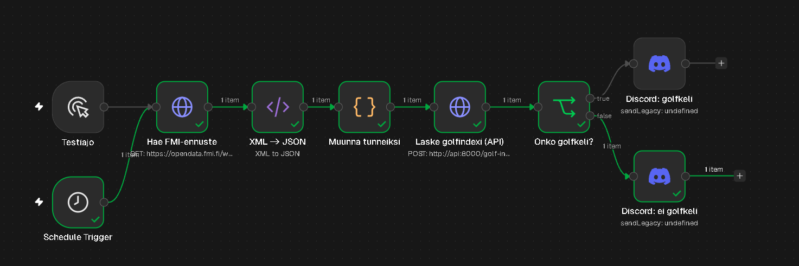
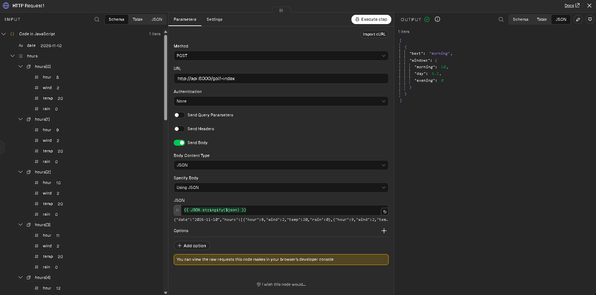

# Golfkeli-botti

Golfkeli-botti ilmoittaa Discordiin joka ilta klo 18, millainen golfkeli huomenna on Porissa ja milloin – aamulla, päivällä vai illalla – on paras aika pelata. Botin laskentalogiikka perustuu viiden golfarin arvioihin siitä, mikä on hyvä golfkeli, ja raja-arvot on laskettu heidän vastaustensa mediaaneista. Ennuste haetaan Ilmatieteen laitoksen avoimesta datasta.


## Miten se toimii

```
Schedule Trigger (klo 18)
        │
        ▼
n8n: Hae FMI-ennuste ──► XML → JSON ──► Muunna tunneiksi
                                              │  UTC → Suomen aika,
                                              │  vain huomisen tunnit
                                              ▼
                        FastAPI: POST /golf-index
                                              │  pisteytys + paras ikkuna
                                              ▼
n8n: Onko golfkeliä? ──► Discord: "Huomenna paras golfkeli: aamu, indeksi 10/10"
                    └──► Discord: "Huomenna ei golfkeliä Porissa"
```



Roolijako on tarkoituksellinen: **n8n hoitaa integraation** (ajastus, datan haku ja muunnos, ilmoitus) ja **FastAPI pelkän laskennan**. Laskentalogiikka on puhdasta Pythonia ilman kehysriippuvuuksia, joten sen voi testata ja käyttää uudelleen erikseen.

## Teknologiat

- **Python 3.13**, **FastAPI**, **Pydantic** – API ja validointi
- **pytest** – yksikkötestit laskentalogiikalle
- **Docker** ja **Docker Compose** – API ja n8n omissa konteissaan
- **n8n** (self-hosted) – workflow-automaatio
- **Ilmatieteen laitoksen avoin data** (WFS, HARMONIE-pistennuste)
- **Discord webhook** – ilmoitukset

## Golfindeksi

Jokainen tunti pisteytetään kolmen tekijän perusteella asteikolla 0–10. Raja-arvot on kerätty **viideltä golfarilta** (vastausten mediaanit), joten ne kuvaavat porukan todellista kelitoleranssia eivätkä yhden ihmisen arvausta.

**Tuuli (m/s)** – ihanne 0–2, maksimi 8

| Tuuli   | 0–2 | 3–5 | 6–7 | 8   | yli 8 |
| ------- | --- | --- | --- | --- | ----- |
| Pisteet | 10  | 8   | 5   | 3   | 0     |

**Lämpötila (°C)** – minimi 10, ihanne 18–23, maksimi 28

| Lämpö   | alle 10 | 10–13 | 14–17 | 18–23 | 24–28 | yli 28 |
| ------- | ------- | ----- | ----- | ----- | ----- | ------ |
| Pisteet | 0       | 5     | 8     | 10    | 7     | 0      |

**Sade (mm/h)** – korkeintaan tihku

| Sade    | pouta (≤ 0,1) | tihku (≤ 0,3) | sade |
| ------- | ------------- | ------------- | ---- |
| Pisteet | 10            | 5             | 0    |

**Yhdistäminen**

- Jos yksikin tekijä saa 0 pistettä, tunti on **pelikelvoton** ja sen indeksi on 0. Kova tuuli ei muutu pelattavaksi, vaikka olisi lämmintä ja poutaa.
- Muuten indeksi on painotettu summa: **tuuli 40 %, sade 40 %, lämpö 20 %**. Kova tuuli ja sade pilaavat kierroksen eniten.
- Päivä jaetaan kolmeen ikkunaan: **aamu 8–12, päivä 12–16, ilta 16–20**. Ikkunan arvo on sen tuntien keskiarvo, joten yksi sadetunti huonontaa ikkunaa selvästi mutta ei nollaa sitä.
- Jos parhaankin ikkunan arvo on 0, botti ilmoittaa, ettei huomenna ole golfkeliä.

## Suunnitteluratkaisut

**Logiikka erillään kehyksestä.** `golf_index.py` ei importtaa FastAPIa eikä Pydanticia. Laskenta testattiin kokonaan ennen kuin API:a oli olemassa, ja `main.py` on ohut kerros, joka vain välittää datan.

**Validointi reunalla.** Pydantic-skeemat hylkäävät _mahdottoman_ datan (negatiivinen tuuli, tunti 25, `NaN`), ja laskentalogiikka arvioi _huonon_ kelin. Pakkanen on huonoa keliä, ei rikkinäistä dataa, joten se pääsee läpi ja saa 0 pistettä. `NaN` estetään erikseen, koska kaikki vertailut sen kanssa ovat epätosia: ilman estoa puuttuva lämpötilamittaus saisi täydet pisteet.

**Tyhjä tai pelikelvoton päivä palauttaa `None`.** Jos kaikki ikkunat ovat nollia, API ei suosittele "parasta" pelikelvotonta ikkunaa, vaan `best` on `null`.

**Aikavyöhyke.** FMI palauttaa ajat UTC:nä, mutta ikkunat ovat Suomen aikaa. Muunnos tehdään n8n:ssä Luxonilla (`Europe/Helsinki`), joten kesä- ja talviaika hoituvat automaattisesti. n8n:n `GENERIC_TIMEZONE` on asetettu, jotta ajastus laukeaa klo 18 Suomen aikaa.

**JavaScript n8n:n Code-nodessa.** Projekti on muuten Pythonia, mutta n8n:n natiivi Python-tila estää oletuksena standardikirjaston importit (myös `datetime`). Muunnos on lyhyt, ja JavaScriptillä n8n:n valmis Luxon-kirjasto hoitaa aikavyöhykkeet ilman asennuksen säätämistä.

**Käännös esityskerroksessa.** API palauttaa ikkunoiden nimet englanninkielisinä avaimina (`morning`, `day`, `evening`), ja n8n kääntää ne viestiin suomeksi. API:n rajapinta pysyy kielestä riippumattomana.

**Salaisuudet.** Discordin webhook-osoite on n8n:n credentials-varastossa, ei workflowssa, joten exportattu `golfkeli.json` ei sisällä sitä.

## API

| Metodi | Polku         | Kuvaus                                                                      |
| ------ | ------------- | --------------------------------------------------------------------------- |
| `GET`  | `/health`     | Elossaolotarkistus                                                          |
| `POST` | `/golf-index` | Ottaa tuntikohtaisen sään, palauttaa ikkunoiden indeksit ja parhaan ikkunan |

Esimerkkipyyntö:

```json
{
  "hours": [
    { "hour": 9, "wind": 2.0, "temp": 20.0, "rain": 0.0 },
    { "hour": 13, "wind": 4.0, "temp": 12.0, "rain": 0.2 },
    { "hour": 17, "wind": 2.0, "temp": 18.0, "rain": 2.0 }
  ]
}
```

Vastaus:

```json
{
  "best": "morning",
  "windows": { "morning": 10.0, "day": 6.2, "evening": 0.0 }
}
```

Dokumentaatio ja testaus selaimessa: `http://127.0.0.1:8000/docs`



## Projektirakenne

```
golfbotti/
├── api/
│   ├── app/
│   │   ├── main.py            # FastAPI-endpointit
│   │   ├── golf_index.py      # laskentalogiikka (puhdas Python)
│   │   └── schemas/
│   │       └── schemas.py     # Pydantic-mallit
│   ├── tests/
│   │   └── test_golf_index.py
│   ├── Dockerfile
│   ├── requirements.txt       # tuotantoriippuvuudet
│   └── requirements-dev.txt   # + pytest
├── n8n/
│   └── workflows/
│       └── golfkeli.json      # exportattu workflow
├── docs/images/
├── compose.yaml
└── README.md
```

## Käynnistys

Vaatii Dockerin.

```bash
git clone https://github.com/waltterir/golfbotti.git
cd golfbotti
docker compose up -d --build
```

- API: `http://127.0.0.1:8000/docs`
- n8n: `http://127.0.0.1:5678`

n8n:n käyttöönotto:

1. Luo n8n:ään omistajatili (paikallinen, tallentuu Docker-volumeen).
2. Tuo workflow: _Import from File_ → `n8n/workflows/golfkeli.json`.
3. Luo Discordiin webhook (kanavan asetukset → Integrations → Webhooks) ja lisää sen URL n8n:ään uudeksi _Discord Webhook_ -credentialiksi molempiin Discord-nodeihin.
4. Testaa _Execute workflow_ -napilla ja julkaise (_Publish_).

Botti toimii niin kauan kuin kontit ovat käynnissä.

## Testit

```bash
cd api
python -m venv venv
venv\Scripts\activate          # Windows (macOS/Linux: source venv/bin/activate)
pip install -r requirements-dev.txt
pytest
```

41 testiä kattavat pisteytysfunktioiden kaikki portaat ja rajakohdat, painotetun indeksin, pelikelvottoman tunnin, ikkunoiden keskiarvot (myös tyhjän ikkunan ja ikkunan ulkopuoliset tunnit) sekä parhaan ikkunan valinnan.

## Tunnetut rajoitukset

- Tyhjä ikkuna (ei dataa) saa arvon 0, eikä vastauksesta erota puuttuvaa dataa huonosta kelistä. Käytännössä n8n lähettää aina koko päivän ennusteen.
- Sateen ja lämpötilan tai tuulen yhteisvaikutusta ei huomioida: lämpimällä kelillä moni pelaisi kevyemmässäkin sateessa.
- Botti toimii vain, kun kone ja kontit ovat päällä.

## Jatkokehitys

- Parhaan ikkunan säätiedot viestiin (lämpötila, kovin tuuli, sademäärä) – laskenta API:iin, jotta se on testattavissa
- Ajo palvelimella (VPS tai pilvi), jotta botti toimii koneesta riippumatta
- Sateen sietokyvyn riippuvuus lämpötilasta ja tuulesta
- Useampi kenttä tai paikkakunta
